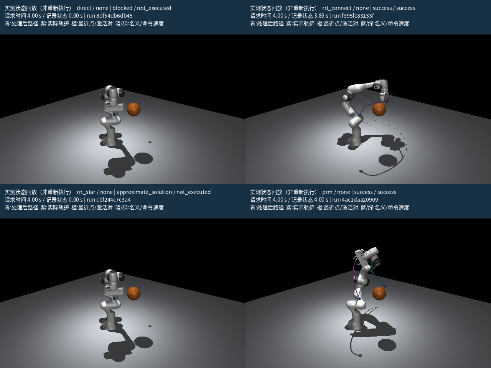
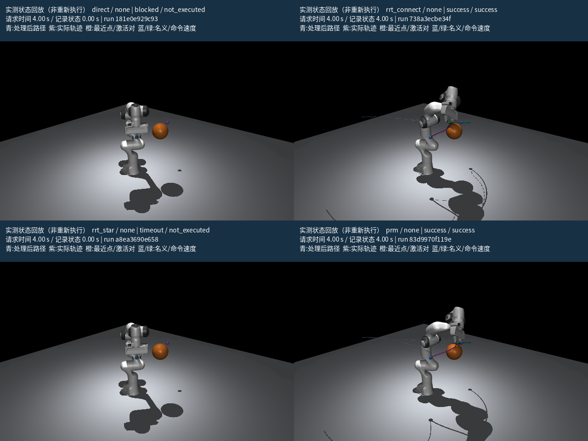
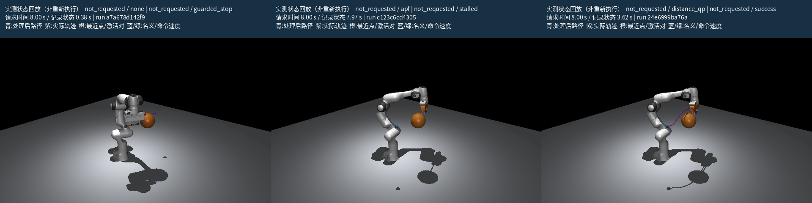
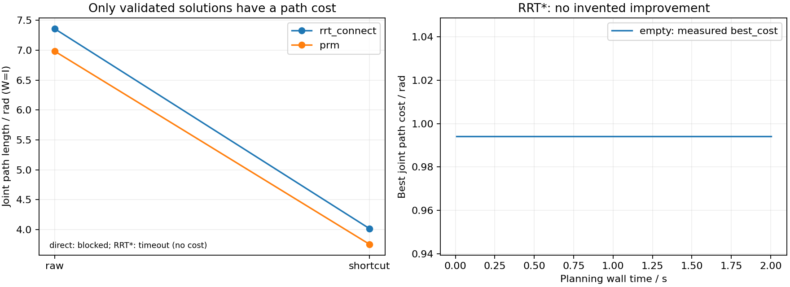
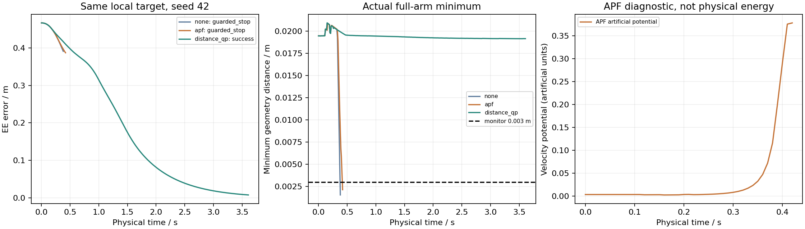

# 怎样复现实验，怎样解释失败

## OMPL 最终集成验证

OMPL 2.0.1 已安装并完成真实回归。[最新报告](evidence/ompl-release/tutorial-report.html)与[验收记录](evidence/ompl-release/acceptance.json)使用新的 OMPL 运行 ID；原有 motion-planners 结果保留为历史证据。宿主机网页打开和 MuJoCo 实时成功由用户提供日志确认，逐项交互检查状态另存 human-validation.json。

本次定位并修复：PRM 短查询时间片导致原生解检查线程未及时处理、Python/C++ 回调引用环、warm PRM 的重复 setup 与默认零目标阈值。新增子进程回归验证多个真实规划器可释放且退出时无 `nanobind: leaked`，cold/warm 和极短预算失败均真实执行。不能用“增大测试预算”或把 approximate_solution 改名 success 来绕过问题。

```bash
python scripts/validate_ompl.py
python -m panda_planning.benchmark --suite tutorial --backend ompl --headless --trace --budget 3 --output outputs/ompl-release
```

当前 OMPL 单障碍实测（seed42，3 s 预算，完整运行 ID 见新报告）：

| 方法 | 规划状态 | 规划墙钟 s | 处理后长度 rad | 执行物理时间 s | 末端误差 m |
| --- | --- | ---: | ---: | ---: | ---: |
| direct | blocked | 0.001 | — | — | — |
| OMPL RRT-Connect | success | 0.050 | 1.5641 | 3.89 | 0.000277 |
| OMPL RRT* | approximate_solution | 3.003 | — | 未执行 | — |
| OMPL PRM cold | success | 2.144 | 7.3573 | 16.29 | 0.002314 |

三查询 PRM 对照完整保留：每组首个 warm 仍是 cold 建图，后续两次 warm 约 0.43/0.39 s，而相应 cold 约 2.07/1.96 s。建图与查询单列，不把 warm 查询与其他算法的完整求解时间直接排名。RRT* 的近似解没有被“目标差距恰好为零”误升格为成功。



以下内容按日期保留原版本的运行条件与限制，历史“缺少 OMPL”的记录不代表当前环境：

## 2026-10-25 完善记录

[最新全局/局部报告](evidence/completion/tutorial-report.html)、[验收记录](evidence/completion/acceptance.json)、[APF 停滞报告](evidence/completion/apf-trap-report.html)、[同路径 hybrid 报告](evidence/completion/hybrid-report.html) 使用本次真实新运行，旧版证据仍按原 ID 保留。





两幅图确实由 MuJoCo EGL 渲染，并已检查相机、中文标注、整臂、障碍尺寸、图例和信息栏遮挡。它们是“实测状态回放”，没有重新求解动力学；frames.json 带 run_id、scene_id、plan_id 和实际时间。与 Chrome/WebGL 交互验收分开，不能用 PNG 声称浏览器按钮已目视通过。

新增真实 APF stalled 案例（增益 0.0002）：约 7.97 s，最终误差 11.51 mm，未放宽 10 mm 到达阈值；对应相同输入 QP 成功、none guarded_stop。`--suite hybrid` 只建立一次全局路径，三种局部策略实测均成功，plan_id 相同。

```bash
python -m panda_planning.demo --scene local_trap --mode local --avoider apf --config configs/apf-trap.yaml --headless --output outputs/apf-stall
python -m panda_planning.benchmark --suite hybrid --headless --trace --output outputs/hybrid-comparison
python -m panda_planning.render --run-dir outputs/first-run --times 0 4 9 --output outputs/frames
PANDA_TEST_RENDER=1 python -m pytest -q
python scripts/acceptance.py --input outputs/completion-benchmark --output docs/evidence/completion
```

另运行 seed7 的 extended 套件，对 empty、single_obstacle、elbow_obstacle、narrow_passage、random_static 和局部三策略以及 PRM 十查询进行代表性回归。其 summary/失败类型与保存输入均保留在 outputs/completion-extended；不删除失败样本。汇总在最新证据的 extended-results.json。

后文表格属于 2026-10-24 原始交付运行；最新数据以对应 run_id 的 CSV/JSON 为准。

本页描述的是本机实际运行，不是预先保证的性能。主要版本是 Python 3.10.20、MuJoCo 3.3.7、mink 0.0.13、NumPy 1.26.4、SciPy 1.15.2、OSQP 1.0.4。完整环境、源码指纹和运行 ID 见 [acceptance.json](evidence/acceptance.json)。本机 3.12 解释器也存在，但终端不能联网获得相应 MuJoCo/mink 轮子；最终使用独立的 3.10 虚拟环境，不修改系统环境。

## 先复现一条闭环

```bash
source .venv/bin/activate
python -m panda_planning.demo --scene single_obstacle --planner rrt_connect --headless --trace --seed 42 --output outputs/first-run
python -m panda_planning.replay --run-dir outputs/first-run --html outputs/first-run/replay.html
```

single_obstacle 把球放在关节直连的中间末端/手掌运动区域。起点和终点均合法；直连中途碰撞。RRT-Connect 搜索并保留真实节点，shortcut 后做更细整路径验证，然后由 MuJoCo 动力学执行。

典型已保存运行：首次路径约 0.064 s，原始关节长度 7.3595 rad，处理后 4.0155 rad；执行约 8.76 s，末端误差 0.0007465 m，实际最小几何距离约 0.01913 m，监测干预 0。动力学期间没有按路径设置 qpos。执行到达需要速度也下降并持续满足 0.2 s；不只看最后一帧位置。

规划几何路径的最小距离与实际执行最小距离分别保存。全局最小值可能来自腕部自碰对；判断障碍是否激活，应同时看最近几何名称和局部 active 列表，不把单一曲线当成“末端到球的距离”。

## 同一组输入的全局对比

```bash
python -m panda_planning.benchmark --suite tutorial --headless --trace --budget 3 --output outputs/tutorial-benchmark
python -m panda_planning.report --input outputs/tutorial-benchmark --output outputs/tutorial-benchmark/report.html
```

每个全局算法读取同一个保存场景文件、同一个 IK 目标构型、同一个控制器和后处理参数；每次在独立子进程执行。下表为 seed42 的实测结果，墙钟耗时会随机器负载变化，精确当前值以 [results.csv](evidence/results.csv) 为准。

| 算法 / 实际后端 | 规划结果 | 规划墙钟 s | 处理后长度 rad | 执行物理时间 s | 最后末端误差 m |
| --- | --- | ---: | ---: | ---: | ---: |
| direct | blocked | 约 0.0014 | — | 未执行 | — |
| RRT-Connect / motion-planners | success | 约 0.064 | 4.0155 | 8.76 | 0.0007465 |
| RRT* / motion-planners | timeout | 约 3.005 | — | 未执行 | — |
| PRM cold / motion-planners | success | 约 2.4 | 3.7539 | 8.15 | 0.0006267 |



这是一个人工选择的教学输入、一个种子，不是普遍排行榜。RRT-Connect 和 PRM 在此例都有可执行路径；RRT* 的超时不证明无路。额外 15 秒 RRT* 运行仍未找到解，保留在 outputs/rrt-star-long；empty 场景则迅速得到精确解，真实最好代价约 0.9941 rad 并保持不变，不能为了好看画出下降曲线。

快照间隔 0.25 s，短于间隔的快速规划只有少数快照。最终图不会随机逐渐显示冒充搜索顺序；HTML 有独立的规划墙钟滑块。图来自真实 TreeNode/OptimalNode 或 roadmap 对象；未获得拒绝采样/逐次重连事件，不伪造这些细粒度行为。显示截断最多 250 个节点、120 条投影边，统计仍用完整数据。

## 局部对照不是全局规划排行榜

local 模式没有全局安全路径；所有策略对同一个 q_goal 计算名义反馈速度。球放在反馈方向上，是主动暴露局部方法局限的教学输入。

| 策略 | 实测结果 | 执行时间 s | 最后误差 m | 如何理解 |
| --- | --- | ---: | ---: | --- |
| none | guarded_stop | 0.38 | 0.39135 | 共同监测器停止实验，不是 none 绕障成功 |
| APF | guarded_stop | 0.42 | 0.38743 | 排斥确有介入，但本组参数和共同加速度限制下未阻止阈值跨越 |
| distance_qp | success | 3.61 | 0.00746 | 达到约定位置/速度/持续时间判据；不等于形式化动力学安全证明 |



```bash
python -m panda_planning.demo --scene local_trap --mode local --avoider apf --config configs/local.yaml --headless --output outputs/local-apf
python -m panda_planning.demo --scene local_trap --mode local --avoider distance_qp --config configs/local.yaml --headless --output outputs/local-qp
python examples/03_local_step.py
```

报告同时显示名义/修正后末端速度方向、速度修正、活跃几何点对、APF 速度势、QP 最小约束余量与求解状态。箭头经点 Jacobian 映射，不称为排斥力。QP 与 APF 的修正量也包括基础限幅影响，不能仅凭修正幅度认定全部来自避障，应核对 active 对和 distance_slack。

本场景的 APF 实测是 guarded_stop，不能无依据写成“已观察到局部极小/振荡”；要观察真正停滞，需调参、看运动量/路径进度窗口及诊断。失败注入单元测试明确验证了 QP 不可行与坏梯度返回；注入不被用来证明真实物理控制成功。

hybrid 实验必须复用同一条保存路径：

```bash
python -m panda_planning.demo --scene-file outputs/first-run/scene.json --mode hybrid --avoider distance_qp --plan-file outputs/first-run/plan.json --headless --output outputs/hybrid-qp
```

实测 hybrid QP 执行成功，plan_id 与 first-run 相同。静态合法路径上局部修正可能很小；本版没有动态障碍或秘密重规划，不能伪造大量介入。

## 固定场景与已知可行参考

| 场景 | 设计目的与真实验收 |
| --- | --- |
| empty | 无外部障碍，验证 IK、保持、轨迹与 RRT* 真实最好代价 |
| single_obstacle | 两端合法但直连被挡；RRT-Connect/PRM 真实绕行成功 |
| elbow_obstacle | 球靠近前臂/腕部，末端点仍有显著净空；中间构型发生整臂风险；RRT-Connect 绕行执行成功，最后误差约 3.90 mm |
| narrow_passage | 两球之间形成局部小间隙，仍允许空间绕行；已保存细验边与真实执行的可行示例，执行约 5.22 s，误差约 0.195 mm。不声称可行路径必须穿过该间隙 |
| local_trap | 故意阻挡名义反馈方向；当前参数下 none/APF 被监测停止，QP 成功 |
| random_static | seed42 生成 3 个球/盒/胶囊候选，检查两端/障碍重叠，保存拒绝原因；没有按规划是否成功筛选。seed42 的 RRT-Connect 实际成功，其他生成实例初始可行性未知 |
| multi_query | 场景固定，端点小幅变化，用于 PRM 路网摊销成本 |
| invalid_cases | [3,0,3] 的不可达 IK，单独记录 ik_unreachable；无效起点与极短预算的单元测试另外覆盖 |

[参考输入与规划记录](evidence/references/) 保留 narrow/elbow/random/empty-RRT* 的实际 scene/plan/summary/trace。这些手工构造、已经验过可行路径的教学输入有选择偏差；不能用它们估计任意随机场景的成功率。生成器 metadata 中的 unknown 表示生成时未通过规划预筛，后续参考实验才提供已知解的证据。

```bash
python -m panda_planning.scenes --generate random_static --seed 42 --output outputs/scene-42.json
python -m panda_planning.demo --scene-file outputs/scene-42.json --headless --output outputs/random
python -m panda_planning.demo --scene invalid_cases --headless --output outputs/invalid
```

场景保存完整形状、尺寸、位姿（quat 默认单位旋转）、目标、q_start/q_goal、生成器和种子。默认 model 指纹与 scene_id 一起记录。改变几何、限位或碰撞标准后，旧 PRM 边不再复用。

## PRM cold/warm 的真实成本

```bash
python -m panda_planning.benchmark --suite prm --headless --budget 1.5 --output outputs/prm-queries
python examples/04_prm_queries.py
```

tutorial 默认只跑 3 个固定查询以控制验收时间；完整 prm suite 跑 10 个固定查询，两组都保留失败。warm 第一查询仍要建图，后续查询才复用。实际端点、validated、build_time、query_time、elapsed 在 [prm-multi-query.json](evidence/prm-multi-query.json)（小套件）与 outputs/prm-queries/multi_query.json（十查询）中；HTML 末尾另列每次建图、查询和累计成本。发生预算中断也保留已消耗阶段时间，不填假零。

不要把 PRM 的 warm_query 时间放进全局四算法的完整规划耗时表。应比较从相同建图起点出发的累计成本，并说明失败样本数。warm 复用的样本更多也可能提高后续查询成功率，不是免费获得了公平优势。

## 验收、安装隔离与显示状态

```bash
python -m pytest -q
python -m pip check
node scripts/check_report.cjs outputs/tutorial-benchmark/report.html
python scripts/acceptance.py
```

真实测试覆盖：端点/边区别、整臂风险、简单梯度有限差分、独立 IK、场景序列化、真实替代采样规划、RRT* 真实实现、PRM cold/warm/失效、shortcut/五次时间缩放、APF/QP 修正、不可行/坏梯度/超时、PD 保持与小轨迹、实际绕障成功、保存路径 hybrid、日志与报告对应，以及从 /tmp、无 DISPLAY、MUJOCO_GL=disable 启动。OMPL 集成测试显式 skip，不把替代库验收冒充它通过。

已经打包 wheel 并安装到 /tmp 的独立 target，从 /tmp 实际运行 empty/direct 到达；断言导入来自安装目录，证明模型/网格/配置/HTML 脚本不依赖项目一和 references。新环境联网安装未能在本沙箱实测，日志如实保留。

浏览器探测：Chrome headless 启动报 `setsockopt: Operation not permitted`；终端下载 OMPL 代理报 `Errno 1`，取消代理直连也不可用。尝试记录位于 evidence。Node VM 已验证真实报告应用脚本的分组、共同尺度、状态映射、播放/暂停、时间滑块、单步、图层开关以及非空 Plotly traces；这使用绘图接口桩验证应用逻辑，**不能替代真实浏览器 WebGL、字体、遮挡和按钮目视验收**。没有伪造屏幕截图、GIF 或视频。两个 PNG 是 Matplotlib 从真实日志绘制的指标图，不是 GUI 截图。

## 已知边界与接下来的三项优化

1. OMPL 真实集成和对象释放现已通过；后续可评估上游新轮子的中间解回调支持，继续记录绑定版本差异。
2. 用户已在宿主机成功打开 HTML，并完成 passive viewer 真实执行；逐项播放、图层与键盘交互确认独立记录，不把能打开等同所有按钮已验证。当前 viewer 主要显示最终搜索快照，复杂规划时间轴在 HTML，活动高亮只用诊断点对/代理线，未实现精细网格逐连杆染色。
3. 增加保存的近障/狭窄通道查询和更多种子，研究 RRT* 长预算、APF 真正停滞/振荡及 QP 参数；优化全几何对遍历与每周期 OSQP setup，扩展面向异步实时系统的墙钟看门狗。当前同步仿真已增加命令时间戳、力矩与数值异常监测。离散边检查、一阶速度约束和简单 PD 都有近似误差，不能宣称连续动力学安全或普遍算法优劣。
